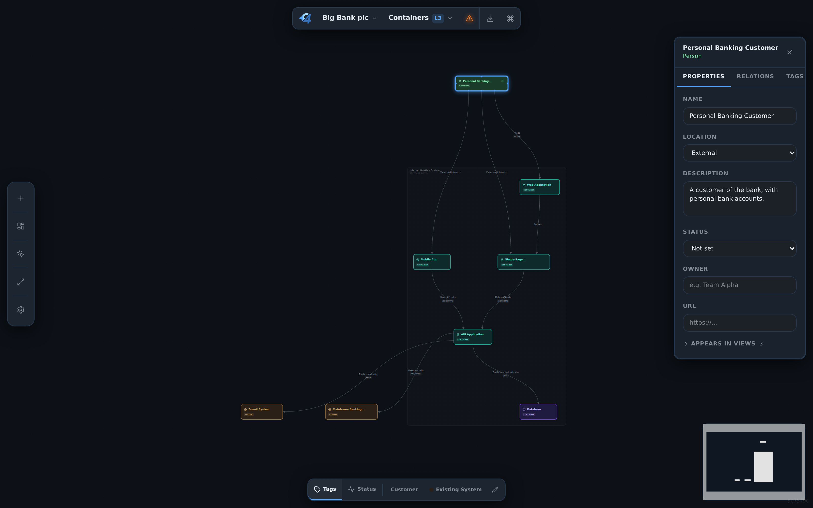

# c4hero for VS Code

Open a Structurizr `.dsl` file as the same visual c4hero canvas available at
[c4hero.com](https://c4hero.com), directly beside your code.

## Use

1. Open a `.dsl` file.
2. Run **c4hero: Open Architecture View** from the Command Palette, or use the
   editor/explorer context action.
3. Edit on the canvas. The underlying text document becomes dirty immediately;
   VS Code Save, Auto Save, undo/redo, source control diffs, Remote SSH and
   filesystem providers continue to work normally.

Canvas layout is saved beside the DSL as `<name>.c4hero.json`. AI provider keys
are optional and stored in VS Code SecretStorage.

The extension contains no server and sends no architecture data to c4hero.
